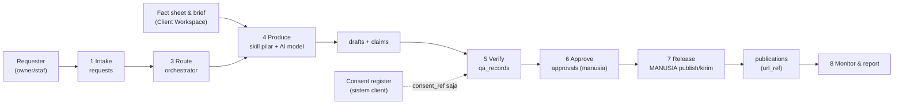

# Data Flow

Alur data dari request sampai monitor, dan di mana data disimpan pada tiap langkah. Zona penyimpanan mengikuti [AI-BOUNDARY.md](../AI-BOUNDARY.md#storage-zones).

## Data per Langkah

| Langkah | Data masuk | Disimpan di | Tidak boleh |
|---|---|---|---|
| Intake | Teks request, kode client, deadline | `requests` | Nama/kontak tamu, credential |
| Route | Intent | `requests.pillar`, `priority` | — |
| Produce | Brief, fact sheet (**DATA FINAL** saja), Voice Card; antrean `ai_jobs`, AI fact-check, catatan `ai_calls` (tanpa isi) | `drafts`, `claims`, `qa_records` (agent), `ai_jobs`, `ai_calls` | Data tamu mentah ke AI model; aset client ke repo; publish otomatis |
| Verify | Draft, consent_ref | `qa_records` | Menyalin isi consent register |
| Approve | Paket approval | `approvals` (+ arsip di workspace client) | Approval lisan tanpa jejak |
| Release | Konten approved | Platform pihak ketiga (oleh manusia) | Publish otomatis oleh AI |
| Monitor | Insight platform (agregat) | Report di workspace client | Export data pengguna mentah ke repo |

## Data Lintas Pilar

Berlaku saat pilar pengirim **dan** penerima aktif (sampai itu: **ASSUMPTION**, dirinci saat aktivasi). Dasar: [5-pillar-architecture § Ketergantungan](../docs/5-pillar-architecture.md#ketergantungan-antar-pilar), AI-CONSTITUTION §4 (minimum data), UU PDP. Pilar 5 Automation hanya **meneruskan** data sesuai baris di bawah; tidak menyimpan salinan sendiri, dan log alurnya tanpa isi.

| Dari → Ke | Boleh mengalir | Bentuk | Tidak boleh |
|---|---|---|---|
| 1 Marketing → 4 BI | Performa konten (reach, engagement, inquiry per post/periode) | Agregat per konten/periode, dengan sumber + waktu tarik | Data pengguna individual dari platform sosial |
| 2 Sales → 1 Marketing | Paket/promo yang disetujui (**DATA FINAL**), tema review/keluhan | Ringkasan tanpa nama | Nama, nomor, isi chat tamu |
| 2 Sales → 3 Admin | Order/booking yang disetujui manusia → quotation/invoice draft | Data pemesan seperlunya untuk dokumen (Confidential, di sistem client/platform) | Data tamu lain di percakapan; data sensitif (kesehatan, agama, keuangan pribadi) |
| 2 Sales → 4 BI | Jumlah inquiry, konversi, waktu respon, tema keluhan | Agregat | Data pribadi tamu |
| 3 Admin → 4 BI | Transaksi & stok per produk/periode | Agregat | Nama pelanggan, nomor rekening |
| 3 Admin → 2 Sales | SOP & katalog terbaru | **DATA FINAL**, berversi | Harga yang belum disetujui |

Data yang tidak ada di tabel ini **tidak** dialirkan antar pilar sampai owner menyetujui baris baru (update tabel ini lewat PR).

## Data ke AI Model

- Hanya teks yang sudah disamarkan (`<NAMA_TAMU>`, `<NO_BOOKING>`) dan fakta yang dibutuhkan.
- Review/DM diperlakukan sebagai **untrusted input**.
- Pilihan provider/model dan kebijakan retensinya dicatat di [integrations.md](./integrations.md) (**CLIENT CONFIRMATION** untuk client yang punya syarat data khusus).
